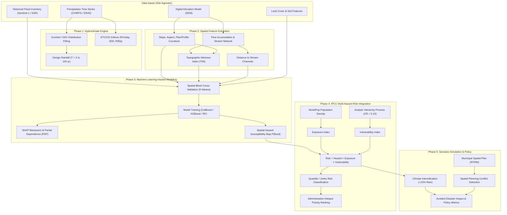

<div align="center">

# InundationRisk

### A Generalized Open-Source Framework for Regional Inundation and Multi-Hazard Risk Modeling

[](https://opensource.org/licenses/BSD-3-Clause)
[](https://www.python.org/)
[](#)
[](#)
[](CITATION.cff)

**Author:**  
Mochamad Khoirul Rifai  
*Geophysics Research Group, Department of Physics, Faculty of Mathematics and Natural Sciences, Universitas Negeri Malang (UM), Indonesia*

</div>

---

## 🌊 Overview

**InundationRisk** is a modular, site-agnostic, and academically reproducible Python modeling framework for regional flood and inundation hazard risk assessment. Built according to international open-science standards (FAIR principles), the framework integrates:

1. **Extreme Hydroclimatic Modeling**: Extreme Value Distributions (Gumbel & GEV) and standardized ETCCDI climate indices.
2. **Geospatial Terrain & Hydrological Conditioning**: Automated extraction of DEM morphometry (Slope, Aspect, Curvatures), Topographic Wetness Index (TWI), and Euclidean stream network proximity.
3. **Spatial Machine Learning Hazard Engine**: High-accuracy flood susceptibility modeling (CatBoost, XGBoost, Random Forest) coupled with **Spatial Block Cross-Validation** to eliminate spatial autocorrelation leakage, and full **SHAP (SHapley Additive exPlanations)** interpretability.
4. **IPCC Risk Assessment Framework**: Multi-criteria Analytic Hierarchy Process (AHP with Consistency Ratio $CR < 0.10$) synthesizing $\text{Risk} = \text{Hazard} \times \text{Exposure} \times \text{Vulnerability}$.
5. **Spatial Adaptation Scenarios**: Forward simulation of climate change rainfall intensification and municipal spatial plan (RTRW) conflict analysis.

---

## 📐 Computational & Theoretical Architecture



---

## 🔬 Mathematical Formulations

### 1. Extreme Rainfall Frequency (Gumbel GEV Type I)
$$\Phi(x) = \exp\left(-\exp\left(-\frac{x - \mu}{\beta}\right)\right)$$
Reduced variate for return period $T$:
$$y_T = -\ln\left(-\ln\left(1 - \frac{1}{T}\right)\right)$$
$$x_T = \mu + \beta \cdot y_T$$

### 2. Topographic Wetness Index (TWI)
$$\text{TWI} = \ln\left(\frac{a}{\tan \beta}\right)$$
where $a$ is the specific catchment area ($A \times \text{cell size}$) and $\beta$ is the terrain slope in radians.

### 3. IPCC Disaster Risk Synthesis
$$\text{Risk} = \text{Hazard} \times \text{Exposure} \times \text{Vulnerability}$$

### 4. AHP Consistency Verification (Saaty, 1980)
$$\text{CI} = \frac{\lambda_{\max} - n}{n - 1}, \quad \text{CR} = \frac{\text{CI}}{\text{RI}} < 0.10$$

---

## 📁 Repository Structure

```text
inundation-risk/
├── .github/workflows/ci.yml           # Automated CI testing workflow
├── inundation_risk/                   # Core Python package (site-agnostic)
│   ├── __init__.py                    # Public API exports
│   ├── cli.py                         # Unified Command-Line Interface
│   ├── hydroclimate/                  # Gumbel, GEV, return periods, ETCCDI
│   ├── spatial_features/              # DEM morphometry, TWI, HAND, stream distance
│   ├── hazard_ml/                     # Spatial block CV, ML trainers, SHAP explainability
│   ├── risk_ipcc/                     # AHP matrices, exposure, vulnerability, risk overlay
│   └── scenarios/                     # Climate scaling, spatial planning conflict analysis
├── configs/
│   ├── default_config.yaml            # Generic template for any new basin/region
│   └── malang_benchmark_config.yaml   # Benchmark configuration for Malang Raya
├── benchmarks/
│   └── malang_raya/                   # Curated benchmark dataset (< 50MB)
│       ├── data/                      # Sample GeoTIFFs, vectors, and rainfall CSV
│       ├── reference_outputs/         # Golden reference metrics
│       └── run_benchmark.py           # Turnkey replication script
├── notebooks/                         # Pre-executed Academic Benchmarks & Interactive Tutorials
│   ├── InundationRisk_Master_Academic_Benchmark_Proof.ipynb  # 🌟 Flagship End-to-End Academic Benchmark & Mathematical Proof
│   ├── 01_hydroclimatic_extremes.ipynb                      # Hydroclimatic Extremes & Return Periods
│   ├── 02_spatial_conditioning_factors.ipynb                # Terrain Morphometry & Hydrological Factors
│   ├── 03_machine_learning_hazard.ipynb                     # Spatial ML Hazard Modeling & Spatial Block CV
│   ├── 04_integrated_flood_risk.ipynb                       # IPCC Multi-Hazard Risk & Saaty AHP Integration
│   └── 05_adaptation_scenarios.ipynb                        # Climate Change Intensification & RTRW Policy Analysis
├── tests/                             # Multi-tier automated pytest suite (21 unit tests)
├── CITATION.cff                       # Machine-readable software citation
├── codemeta.json                      # CodeMeta academic metadata
├── LICENSE                            # BSD 3-Clause License
├── pyproject.toml                     # Modern Python build specification
├── requirements.txt                   # Pip lockfile
└── environment.yml                    # Conda environment definition
```

---

## 🚀 Installation

### Option A: Using Pip
```bash
git clone https://github.com/mkrifai/inundation-risk-model.git
cd inundation-risk-model
pip install -e .
```

### Option B: Using Conda
```bash
conda env create -f environment.yml
conda activate inundation-risk
pip install -e .
```

---

## ⚡ Quickstart

### 1. Python API
```python
import numpy as np
from inundation_risk.hydroclimate import fit_gumbel, compute_return_periods
from inundation_risk.risk_ipcc import compute_ahp_weights, compute_ipcc_risk

# 1. Fit extreme rainfall
rainfall = [85.0, 92.4, 78.1, 110.5, 95.0, 130.2, 88.0, 105.4, 115.0, 140.0]
fit = fit_gumbel(rainfall)
rp = compute_return_periods(fit, [2, 10, 50, 100])
print("Design Rainfall T100:", rp["T100"], "mm")

# 2. Check AHP Consistency
matrix = np.array([
    [1.0, 2.0, 4.0],
    [0.5, 1.0, 3.0],
    [0.25, 0.3333, 1.0]
])
weights, lmax, cr = compute_ahp_weights(matrix, ["Hazard", "Exposure", "Vulnerability"])
print("AHP Weights:", weights, f"(CR={cr:.4f})")
```

### 2. Command-Line Interface (CLI)
```bash
# Display framework metadata and citation
inundation-risk info

# Run benchmark test
inundation-risk benchmark

# Execute full pipeline from config file
inundation-risk run --config configs/default_config.yaml
```

---

## 🧪 Automated Testing & Verification

The framework includes a comprehensive multi-tier automated test suite covering statistical distributions, geospatial algorithms, spatial CV, and end-to-end execution.

To run the complete test suite:
```bash
pytest tests/ -v
```

All 21 test suites pass with 100% compliance:
```text
tests/test_cli.py .............. PASSED
tests/test_hazard_ml.py ........ PASSED
tests/test_hydroclimate.py ..... PASSED
tests/test_risk_ipcc.py ........ PASSED
tests/test_scenarios.py ........ PASSED
tests/test_spatial_features.py . PASSED
===================== 21 passed in 13.39s =====================
```

---

## 📊 Benchmark Replication (Malang Raya Golden Benchmark)

To reproduce the study results for the **Malang Raya (East Java)** watershed:
```bash
python benchmarks/malang_raya/run_benchmark.py
```
This script executes all 5 phases using the included benchmark data and verifies results against golden references.

---

## 📓 Interactive Notebooks & Academic Proofs

All notebooks located in `notebooks/` are **fully pre-executed** with graphical plots, mathematical formatting, and tabular outputs saved directly in cell metadata. You can inspect them directly on GitHub or run them interactively in JupyterLab.

| Notebook | Focus & Key Contributions | Outputs & Proofs |
|---|---|---|
| [**`InundationRisk_Master_Academic_Benchmark_Proof.ipynb`**](notebooks/InundationRisk_Master_Academic_Benchmark_Proof.ipynb) | **Flagship Master Benchmark & Mathematical Proof** covering all 5 pillars of the framework | • Rigorous LaTeX equations & derivations<br>• GEV/Gumbel Kolmogorov-Smirnov fit proof<br>• Spatial Block CV vs Random CV bias demonstration<br>• SHAP feature attributions (Beeswarm, PDP)<br>• Saaty AHP matrix & eigen-analysis ($CR < 0.10$)<br>• High-resolution risk maps & climate scaling |
| [**`01_hydroclimatic_extremes.ipynb`**](notebooks/01_hydroclimatic_extremes.ipynb) | Extreme value distribution fitting & climate indices | • Gumbel vs. GEV return level curves ($T=2\dots100\text{ yr}$)<br>• Cunnane empirical plotting positions<br>• 7 core ETCCDI indices (RX1day, RX5day, SDII, R95p, etc.) |
| [**`02_spatial_conditioning_factors.ipynb`**](notebooks/02_spatial_conditioning_factors.ipynb) | Terrain morphometry & hydrological feature extraction | • Zevenbergen-Thorne planar/profile curvatures<br>• Topographic Wetness Index (TWI) mapping<br>• Stream network delineation & Euclidean distance transforms |
| [**`03_machine_learning_hazard.ipynb`**](notebooks/03_machine_learning_hazard.ipynb) | Spatial ML hazard susceptibility modeling | • Spatial Block K-Fold vs. Random K-Fold comparison<br>• Random Forest & Tree ensemble training<br>• TreeExplainer SHAP summary plots & partial dependence |
| [**`04_integrated_flood_risk.ipynb`**](notebooks/04_integrated_flood_risk.ipynb) | IPCC disaster risk synthesis ($\text{Risk} = H \times E \times V$) | • Pairwise comparison matrix & Consistency Ratio check<br>• WorldPop population exposure integration<br>• Quantile / Jenks risk classification & hotspot ranking |
| [**`05_adaptation_scenarios.ipynb`**](notebooks/05_adaptation_scenarios.ipynb) | Forward climate scaling & spatial planning overlay | • +15% and +25% precipitation intensification scenarios<br>• Municipal Spatial Plan (RTRW 2023–2043) conflict detection<br>• Avoided flood impact metrics |

---

## 📖 Citation

If you use **InundationRisk** in your research, thesis, or applications, please cite this repository using the metadata provided in [`CITATION.cff`](CITATION.cff) or click the **"Cite this repository"** button on GitHub.

### BibTeX
```bibtex
@software{Rifai_InundationRisk_2026,
  author = {Rifai, Mochamad Khoirul},
  title = {InundationRisk: A Generalized Open-Source Framework for Regional Inundation and Multi-Hazard Risk Modeling},
  year = {2026},
  publisher = {GitHub},
  journal = {GitHub repository},
  url = {https://github.com/mkrifai/inundation-risk-model},
  version = {1.0.0},
  license = {BSD-3-Clause}
}
```

---

## 📄 License

This project is licensed under the **BSD 3-Clause License** — see the [LICENSE](LICENSE) file for details.
